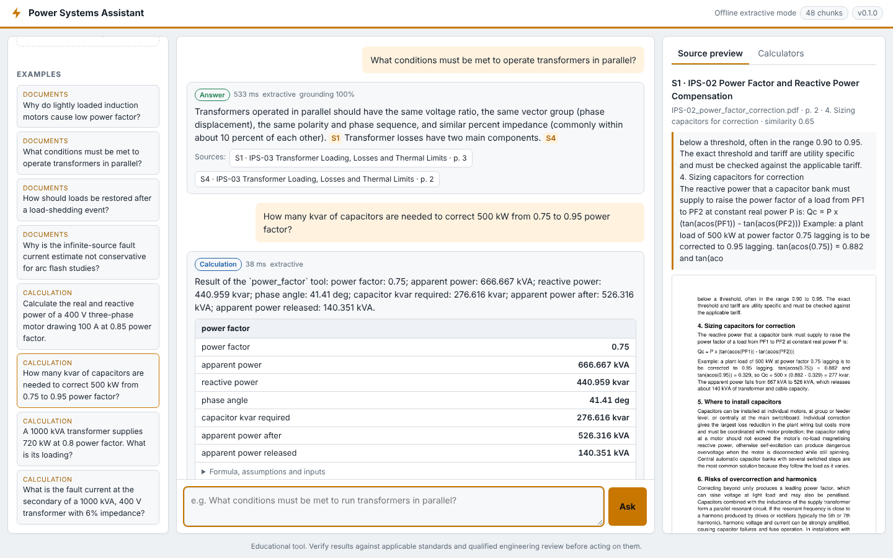

# Industrial Power Systems AI Assistant

A document-grounded assistant for electrical power-systems questions. It answers from
indexed PDFs with page-level citations, abstains when the evidence is insufficient, and
routes numerical questions to tested, deterministic calculators. The language model never
performs the arithmetic.



## What it does

- **Grounded Q&A (RAG):** PDF ingestion with PyMuPDF, page-aware chunking, Chroma vector
  search with ONNX MiniLM embeddings fused with BM25, metadata filtering by document, and
  citations to the page (or page range) of each passage. Clicking a citation shows the
  passage and a rendered image of the PDF page.
- **Abstention and clarification:** answers only when retrieval clears a relevance gate;
  asks for clarification on vague questions or calculations with missing inputs.
- **Calculators** (`app/tools/power.py`), each with explicit units, validation, formulas,
  assumptions and warnings:
  three-phase power, power factor and capacitor sizing, transformer loading, losses and
  efficiency, generation-demand balance with N-1 check, hypothetical priority-based load
  shedding, feeder voltage drop, and transformer short-circuit current.
- **Two answer modes:**
  - `llm`: any OpenAI-compatible Chat Completions API writes the answer from retrieved
    sources as JSON with citation ids, which are validated. The LLM may also pick a
    calculator and propose arguments; Python validates and computes.
  - `extractive` (no API key): the most relevant source sentences are quoted verbatim with
    citations, and a rule-based parser extracts calculator inputs. Everything works offline.
- **Safety:** prompt-injection screening of questions and documents, citation validation,
  numeric grounding checks, upload limits, CSP, rate limiting, optional admin token. See
  [docs/SECURITY.md](docs/SECURITY.md).

## Architecture

```
Browser (vanilla JS, CSP)  ──►  FastAPI (app/main.py)
                                   │
                    Assistant.ask (app/assistant.py)
          ┌──────────────┬─────────┴─────────┬──────────────────┐
   injection screen   calculation router   ambiguity check   retrieval
   (security.py)      parser.py / LLM tool  (vague terms)    store.py: Chroma (cosine)
                      call ─► registry.py                      + BM25 fusion
                      ─► power.py (Pydantic)                   │ relevance gate
                                                               ▼
                                              generate.py: LLM JSON answer or extractive
                                              grounding.py: citation + number checks
```

Why Chroma: it runs embedded with no separate service, persists to disk, supports metadata
filters, and ships a CPU ONNX embedding model, so the container needs no GPU or paid
embedding API. The trade-off is single-node scale, which suits a document assistant of this size.

## Quick start

Requires Python 3.13 and [uv](https://docs.astral.sh/uv/).

```bash
uv sync                                  # exact versions from uv.lock
cp .env.example .env                     # optional: add LLM_API_KEY for llm mode
uv run python scripts/ingest_corpus.py   # index data/corpus (also done automatically on first start)
uv run uvicorn app.main:app --reload     # http://localhost:8000
```

The first run downloads the 79 MB MiniLM ONNX model to `~/.cache/chroma`.

With Docker:

```bash
docker compose up --build                # http://localhost:8000
```

The image downloads the embedding model and builds the sample index at build time, so it
needs no network at runtime apart from the optional LLM API.

### Configuration

All settings are environment variables (see `.env.example` and `app/config.py`):

| Variable | Default | Purpose |
|---|---|---|
| `LLM_BASE_URL` | `https://api.openai.com/v1` | Any OpenAI-compatible endpoint |
| `LLM_API_KEY` | empty | Empty means offline extractive mode |
| `LLM_MODEL` | `gpt-4o-mini` | Model name for that endpoint |
| `LLM_PRICE_INPUT_PER_MTOK` / `..._OUTPUT_...` | 0 | USD per 1M tokens, for cost reporting |
| `TOP_K`, `MIN_RELEVANCE` | 5, 0.35 | Retrieval depth and semantic relevance gate |
| `MAX_UPLOAD_MB`, `MAX_PDF_PAGES` | 15, 300 | Upload limits |
| `ADMIN_TOKEN` | empty | Bearer token required for upload/delete when set |
| `RATE_LIMIT_PER_MINUTE` | 30 | Per-IP limit on POST/DELETE |

## API

Interactive docs at `/api/docs`.

| Method | Path | Description |
|---|---|---|
| GET | `/api/health` | Status, mode, indexed chunk count |
| POST | `/api/chat` | `{question, doc_ids?, top_k?}` → status, answer, citations, calculation, grounding, latency, usage |
| GET | `/api/tools` | Calculator names and JSON schemas |
| POST | `/api/calculate` | `{tool, args}` → structured result, or 422 with per-field errors |
| GET / POST / DELETE | `/api/documents` | List, upload (PDF) and delete documents |
| GET | `/api/documents/{id}/pages/{n}.png` | Rendered page for source preview |
| GET | `/api/chunks/{chunk_id}` | Full text and metadata of a cited passage |

`status` is one of `answered`, `calculation`, `abstained`, `needs_clarification`, `rejected`.

## Sample corpus

`data/corpus/` holds seven short reference notes (21 pages) written for this project and
rendered to PDF from `data/corpus_src/*.md` by `scripts/build_corpus.py`. They contain no
standards text, vendor data or site information, and every worked example in them was
checked numerically. Upload your own text-based PDFs through the UI or API; scanned PDFs
need OCR, which is not included.

## Evaluation

`eval/benchmark.jsonl` has 57 questions: 22 retrieval, 8 explanation, 12 calculation,
5 ambiguous, 7 insufficient-evidence and 3 prompt-injection. Gold pages are found by
searching each item's evidence phrase in the PDFs, and expected calculator outputs were
computed independently of the tool code.

```bash
uv run python eval/run_eval.py --mode extractive      # offline
uv run python eval/run_eval.py --mode llm --llm-judge # needs LLM_API_KEY
```

Each run rebuilds the index in a temp directory and writes `reports/eval_<mode>_<tag>_<time>.{json,md}`.

**Measured results, extractive mode** ([full report](reports/EVAL_REPORT_extractive.md)):

| Metric | Baseline run | After fixes |
|---|---|---|
| Recall@1, hybrid / semantic-only | 93.3% / 86.7% | 100% / 100% |
| Recall@5 | 100% | 100% |
| Citation precision / hit rate | 86.9% / 96.4% | 93.9% / 100% |
| Key-fact recall in answers | 78.6% | 73.3% |
| False abstention rate | 6.7% | 0% |
| Calculation accuracy (12 items) | 91.7% | 100% |
| Ambiguous → clarification / insufficient → abstain / injection → reject | 100% / 100% / 100% | 100% / 100% / 100% |
| Latency p50 / p95 (in-process) | 323 / 508 ms | 331 / 522 ms |

The baseline run found real bugs: sentences split across PDF pages, a load-shedding detector
that fired on conceptual questions, and generator phrasing the parser missed. Fixes were made
**after** seeing benchmark failures, so the "after" column is optimistic. Retrieval is saturated
on this small corpus and cannot separate hybrid from semantic search after the fixes. Key-fact
recall is the weak point of extractive mode, because it can only quote sentences. LLM-mode
numbers will be added once an API key is configured; none are claimed here.

## Tests and CI

```bash
uv run pytest --cov=app        # 99 tests: tools, parser, PDF safety, RAG, API, security, mocked LLM
uv run ruff check . && uv run ruff format --check .
```

GitHub Actions (`.github/workflows/ci.yml`) runs lint, tests with an 80% coverage floor, the
offline evaluation with regression thresholds (`eval/check_thresholds.py`), `pip-audit`,
bandit-style lint, and a Docker build with a container smoke test.

## Deployment

Recommended low-cost host: **Google Cloud Run**. It scales to zero, so cost is near zero when
idle and the free tier covers light use. It needs 2 GiB memory.

```bash
PROJECT_ID=my-project REGION=europe-west1 ./deploy/cloudrun.sh
```

The script builds with Cloud Build, pushes to Artifact Registry, wires secrets from Secret
Manager, deploys, and runs `deploy/verify.py` against the live URL. That script checks health,
security headers, a cited answer, an abstention, a calculator result and injection rejection.
`render.yaml` is an alternative for Render.

Cloud Run's filesystem is ephemeral. The bundled sample index survives restarts because it is
in the image, but uploaded documents do not. For persistent uploads, mount a volume (Cloud
Run GCS volume mount or a Render disk) at `/app/data`.

## Limitations

- The benchmark is small and was written by the same author as the corpus; read it as a
  regression suite, not as a claim of general accuracy.
- Extractive mode quotes sentences; it cannot synthesise across passages. LLM mode can, but
  its quality depends on the chosen model.
- Calculations assume balanced, sinusoidal, steady-state conditions; see each result's
  assumptions. Load-shedding output is a hypothetical planning aid, not an operating instruction.
- Docker image is about 1.5 GB because of Chroma's dependencies.
